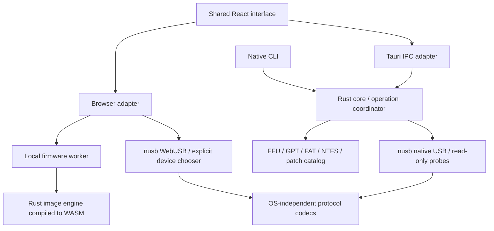

# Architecture

The website is static. There is no device-data backend, telemetry, local HTTP
bridge, or dependency on an online firmware service. Browser USB permission is
requested on the main thread; heavy file reads and extraction execute in a worker.
Large exports use a user-selected streaming file writer; a download-Blob fallback
is limited to 64 MiB. Failure aborts the streaming output before publication.

The operation coordinator serializes native work, validates transitions, and
supports safe-boundary cancellation. Caller-provided plans cannot bypass the
capability gate. Firmware/GPT image operations use checked ranges and bounded
metadata allocations. Catalog patches match complete SHA-1 identities and
expected bytes before modifying targets; source artifacts remain untouched.

Stock-flash v1/v2 streaming is currently exercised only through the concrete
ReplayTransport. It validates platform equality and image hashes, and treats an
uncertain write acknowledgement as recovery-required without retrying. This API
cannot accept the native USB adapter. Device-side signing-catalog authentication,
trusted compatibility evidence, reconnect verification, and post-flash validation
must be established before a real flash executor is exposed.

The Spec A, Spec B, and WP7 family values are distinct research/profile categories.
They are not implementation claims. The complete unlock state machines are pending.

Mode-transition orchestration is also restricted to concrete replay transports.
It distinguishes send-only reboot requests from acknowledged context changes,
requires removal only for routes that reconnect, and re-probes each returning
candidate. USB serial correlation never grants authenticated identity or a device
write capability. Shared frontends expose previews and read-only comparisons;
native mode-change execution/monitoring is not implemented.
