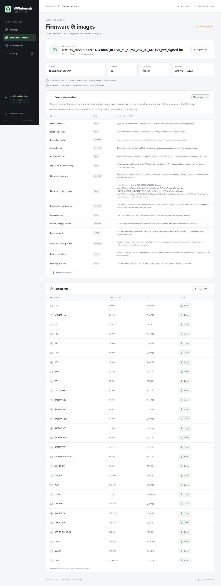

# Firmware evidence before recovery

Firmware inspection now verifies the legacy FFU signing catalog independently
from its payload chunk hashes. Both native Rust and the browser WASM worker use
the same verifier. No network, host trust store or phone-mode change is used.
Recovery remains blocked, and exported preparation reports cannot enable writes.

| Check | What a passing result establishes | Remaining limit |
| --- | --- | --- |
| Catalog signature | Embedded key verifies RSA/SHA-256 signature and mandatory signed attributes | Embedded certificates are not independently trusted |
| Signed hash-table binding | Signed `HashTable.blob` member matches the actual FFU hash table | SHA-1 members are legacy evidence, not modern collision resistance |
| Firmware signer trust | Currently always unverified | OEM chain, device root-key binding, certificate policy/time and revocation need validation |
| Firmware version in image | PLAT `SWVERSION`, or agreeing MainOS registry and DSM package revisions | Metadata alone does not establish applicability |
| Installed / image firmware | Compares observed four-component versions within a branch | Ordering does not approve upgrades or downgrade acceptance |

Native preparation still verifies the complete SHA-256 chunk table, records a
full-file fingerprint, supports cancellation and checks source-file metadata for
changes. Browser preparation verifies the catalog and its table binding from
bounded header bytes, then scans PLAT in 64 KiB blocks and uses the MainOS fallback
when PLAT has no version. Full-file fingerprint and
payload chunk verification remain unverified in the browser. No multi-gigabyte
file is passed through UI messages.

## Supported verification profile

The parser supports DER CMS/PKCS#7 SignedData carrying a Windows CTL, one
issuer/serial signer, an embedded RSA key of 2048–4096 bits, and RSA PKCS#1 v1.5
with SHA-256 signed attributes. Content-type and message-digest attributes must
each occur exactly once with one value. Unsupported profiles stay unverified;
malformed structures, conflicting attributes or bad signatures fail.

Catalogs are capped at 1 MiB; each decoded ASN.1 block is capped at nesting 24
and 4096 nodes (including CTL inside CMS octet strings). Embedded
certificates at 16 and signed attributes at 32. A single, explicitly named UTF-16
`HashTable.blob` member must contain a supported indirect-data SHA-1 or SHA-256
digest. Arbitrary digest bytes elsewhere in the catalog do not establish binding.
No external/detached content is accepted. RSA is used only for public verification.

Legacy PKCS#7 sequence content hashes its value octets; CMS octet content hashes
the enclosed content bytes. This distinction follows
[RFC 5652 sections 5.2.1 and 5.4](https://www.rfc-editor.org/rfc/rfc5652).
Windows catalog/CTL member semantics are described by Microsoft in
[catalog files](https://learn.microsoft.com/en-us/windows-hardware/drivers/install/catalog-files),
[CTL_INFO](https://learn.microsoft.com/en-us/windows/win32/api/wincrypt/ns-wincrypt-ctl_info),
and [CTL_ENTRY](https://learn.microsoft.com/en-us/windows/win32/api/wincrypt/ns-wincrypt-ctl_entry).
ASN.1 CMS/X.509 decoding uses [RustCrypto CMS](https://docs.rs/cms/0.2.3/cms/).

PLAT scanning follows the version source used by pinned upstream 2.9.2
`Models/FFU.cs::GetFirmwareVersion`. The scanner accepts four bounded numeric
components with NUL/CR/LF termination, preserves boundary fragments, rejects
contradictory values, and scans at most 64 MiB. Missing metadata stays missing;
filenames are never used as firmware-version evidence. A numerically older build
within the same branch fails preparation because no downgrade profile is
validated. Different branches and newer builds stay unverified. A dot-delimited
image-platform prefix is advisory family evidence, rather than a false exact
match or proof of phone acceptance.

When PLAT has no version, the fallback looks up exactly these MainOS NTFS files:

- `Windows/Packages/RegistryFiles/Nokia.DeviceInfo.PhoneFirmwareRevision.reg`
- `Windows/Packages/DsmFiles/Nokia.DeviceInfo.PhoneFirmwareRevision.dsm.xml`

It reads `SYSTEM\Platform\DeviceTargetingInfo`'s `PhoneFirmwareRevision` from
the registry package and requires the DSM identity to be Nokia / DeviceInfo /
PhoneFirmwareRevision, MainOS, non-removal, with an agreeing numeric version.
DSM numeric attributes can omit registry leading zeroes. Both files are required
if either is present. Missing files, unsupported filesystem profiles and ambiguous
or corrupt metadata cannot establish a version. This narrow profile does not parse
registry hives or establish that package staging data matches a live phone registry.
PLAT remains authoritative when present; this fallback does not cross-check MainOS
in that case. Reports retain the exact source locations.

Stored and expanded package files are limited to 64 KiB each. Single-member gzip
checks CRC/length and rejects trailing bytes or additional members. UTF-16LE with
BOM and UTF-8 registry text are supported; DSM requires UTF-8, the ImageUpdate
namespace, no DTD, at most 16 levels and 4096 elements. A partition-relative sparse
FFU reader limits seeks to MainOS, uses a 64 KiB cache, caps fetched data at 16 MiB
and read calls at 65536. It does not reconstruct the whole partition or mount it.
The same Rust NTFS/package implementation runs natively and in WASM.

The browser worker supplies at most 64 KiB slices through
[FileReaderSync](https://developer.mozilla.org/en-US/docs/Web/API/FileReaderSync),
which is available in dedicated workers. Cancellation is checked immediately
before and after the bounded synchronous NTFS batch; it cannot interrupt an
individual synchronous file read. Unsupported browsers get a desktop fallback
explanation. No MainOS image bytes are sent to the UI or a server.

## Local RM-875 result

The original local FFU fingerprint stayed unchanged. Rust and Windows
`.NET SignedCms.CheckSignature(true)` agreed on its valid RSA/SHA-256 signature;
Rust also verified the legacy SHA-1 hash-table member. The browser produced an
identical catalog report. Its certificate identifies Nokia, but no independent
OEM trust anchor or phone acceptance has been established.

The 8 MiB PLAT partition has no `SWVERSION` record. MainOS's gzip-compressed
registry and DSM package files agree on `3051.50009.1424.0002`; the DSM represents
the final component as `2`. Native and production browser WASM agree, and Python's
gzip/UTF-16/XML readers independently confirm these package values. The previously
observed phone version is `3051.50009.1451.1003`. Preparation now reports the image
as an older build in the same branch and fails its downgrade check. This does not
prove the phone would reject it; no downgrade workflow has been validated.
See the [catalog evidence](../tests/fixtures/rm875-catalog-validation.json) and
[MainOS metadata evidence](../tests/fixtures/rm875-mainos-validation.json).

Synthetic fixtures contain a disposable self-signed test certificate and no OEM
bytes or saved private key. Both PKCS#7 and CMS positive signatures were checked
independently with Windows/.NET. Windows' signature-only checker accepts the
duplicate-digest fixture; this implementation deliberately rejects ambiguous
critical attributes. Tests also cover altered signatures/content/tables,
unsupported algorithms, malformed lengths/depth, chunk-boundary version scans,
contradictions, cancellation, advisory prefix matching, version ordering, and
browser recovery gating. Successful mathematical checks never grant signer trust
or authorize a phone write.

