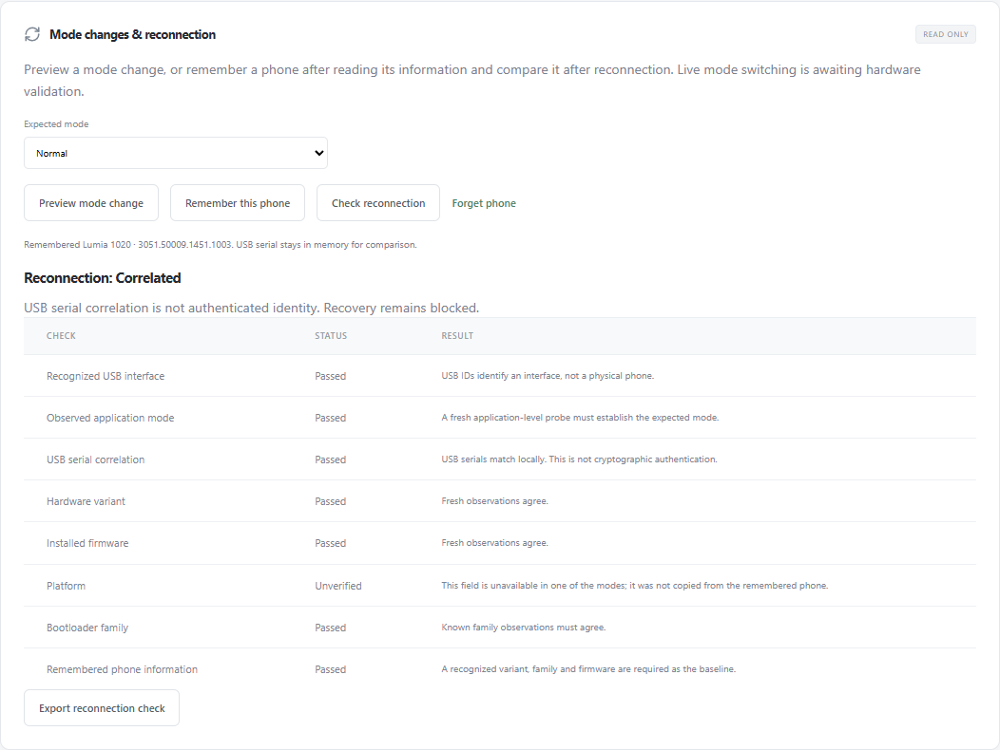

# Mode transitions and reconnection

Live mode switching remains blocked. The implemented transition engine accepts
only concrete replay transports, and cannot be given a native USB or WebUSB
handle. CLI, browser and desktop expose advisory previews and read-only identity
comparisons. No preview or comparison can authorize flashing.

## Reviewed routes

The baseline is WPInternals 2.9.2, commit
`d8fd0aa516b16dc094df0422a3adc525af005c29`, specifically
`ViewModels/SwitchModeViewModel.cs` and `Models/NokiaFlashModel.cs`.

| Source | Target | Command | Observation required |
| --- | --- | --- | --- |
| Normal | Flash | JSON-RPC `SetDeviceMode`, `DeviceMode=Flash`, `ResetMethod=HwReset` | Removal followed by fresh arrival/probe |
| Flash / BootManager | Normal | `NOKR`, send only | Removal followed by fresh arrival/probe |
| BootManager protocol 1 | Flash | `NOKS`, send only | Removal followed by fresh arrival/probe |
| BootManager protocol 2 | Flash | `NOKS`, send only | Fresh probe; removal is not required |
| Flash protocol 2 | BootManager / PhoneInfo | `NOKXCBB` / `NOKXCBP` | Status response followed by fresh probe |
| PhoneInfo protocol 2 | Flash | `NOKXCBF` | Status response followed by fresh probe |

Unknown protocol versions, unknown families, WP7, mass storage, emergency routes
and same-mode resets are rejected. In particular, `NOKS` is not sent from Flash:
the upstream source warns that this can leave the phone unresponsive. The existing
generic context byte builder is not a route policy or live executor. Context
response signatures are strict replay assumptions awaiting captured hardware
responses. Upstream timeout-disabling commands are not ported or sent implicitly.

## Transition replay

Replay re-reads normal information or NOKV/FVER before issuing one mode command.
Source contradictions stop before that command. It distinguishes cancellation
before sending from interruption after delivery. Partial/failed delivery can be
ambiguous: the engine inspects fresh observations without retrying the command.

Reconnection uses an absolute 30-second simulated deadline. Permission requests
do not reset it. Required removal must precede an arrival; stale enumeration is
ignored. Zero/multiple returning candidates, missing serials, contradictory
identity, unexpected application modes, malformed probes, or a timeout end with
`recovery_required`. An in-place context switch still requires a fresh probe.
Observations are bounded, with monotonic elapsed times and no sleeps or USB access.

```sh
python scripts/generate-mode-fixture.py
cargo run -p wpi-cli -- replay-mode tests/fixtures/mode-normal-to-flash.json
```

The fixture is entirely synthetic; its successful replay is not hardware evidence.
These routes do not yet implement native monitoring, a live executor, automatic
return-to-normal, or browser mode changes.

## Read-only check on a connected phone



1. Refresh the UI and select your phone. Click **Read device information**.
2. Click **Remember this phone**. The baseline stays in application memory until
   you forget it or reload. It is retained across page changes and USB removal.
3. Choose the expected mode. For an ordinary unplug/replug test, choose **Normal**.
4. Unplug/reconnect the USB cable, then select the phone again. No reboot is needed.
5. Click **Check reconnection** to run fresh read-only information queries.
   Export the report if useful. A disconnect discards late probe results.

The panel displays progress while reading and shows errors beside the button,
including USB `NotFoundError` and `AbortError`. These are device failures, not
silent file-picker cancellations. If a transfer is interrupted, unplug the phone,
scan while disconnected, reconnect, and select it again before retrying. No mode
change is sent by this check.

The report says `correlated` only when nonempty USB serials match, the baseline
has a known variant/family and firmware, the interface and application mode agree,
and no available variant, firmware, platform or family observations contradict it.
Missing serials return `unverified`, even when the model and firmware match.
Contradictions return `mismatch`. Mode-specific missing fields stay unverified;
the adapter does not copy them from the old phone observation.

USB serials are unauthenticated descriptors. Correlation is not cryptographic
identity, firmware applicability, or recovery authorization. All reports retain
`recovery_authorized=false`; previews retain `executable=false`. Exports omit
serial and instance identifiers, and changing JSON cannot bypass the Rust gate.

Native equivalents:

```sh
wpi prepare-mode '<selected-device-id>' flash
wpi probe '<selected-device-id>' > baseline.json
# After unplugging/reconnecting, discover and explicitly select the new ID:
wpi check-reconnect baseline.json '<new-device-id>' normal
```

The local CLI probe baseline contains the USB serial; keep it local. The comparison
output and preparation export do not contain that serial. Actual mode changes on
the 1020 and 730 require a separately validated executor and hardware evidence.
