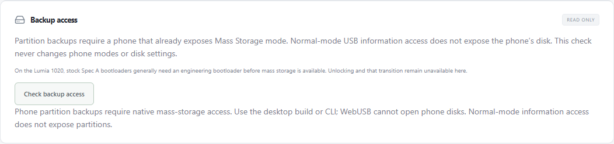

# Experimental read-only native backup

For files already visible while the phone is in Normal mode, a separate
[Windows MTP file-copy helper](mtp-file-backup.md) has now copied and verified
the test 1020's three exposed files. That limited file backup does not expose raw
partitions or establish mass-storage backup access described below.

The Windows CLI can inspect and copy a recognized phone disk that **already
exposes mass storage**. This is research functionality, not hardware-validated
Lumia backup support. No real phone disk has been copied yet. macOS/Linux raw
storage adapters remain unimplemented; those builds return an explicit unsupported
result. The shared copy, layout and policy tests run on all native CI targets.

The browser's **Check backup access** explains desktop fallback without asking
for USB permission. The same button in the desktop app lists Windows storage
candidates and unmet state checks. It neither opens raw disks nor performs a
backup. Actual inspection/copy is CLI-only in this milestone.

## Important limitation for the connected Lumia 1020

Normal-mode Nokia information queries and MTP do not expose a block disk. The
pinned upstream backup workflow uses `MassStorage`, and its Spec A mode-change
path states that an engineering SBL3 is needed to enable that mode. See
[upstream backup](https://github.com/ReneLergner/WPinternals/blob/d8fd0aa516b16dc094df0422a3adc525af005c29/ViewModels/BackupViewModel.cs)
and [Spec A switching](https://github.com/ReneLergner/WPinternals/blob/d8fd0aa516b16dc094df0422a3adc525af005c29/ViewModels/SwitchModeViewModel.cs).
Consequently, this path cannot provide a pre-unlock full-disk backup of a retail
1020 still running its normal OS. This app does not install that bootloader,
request mass-storage mode, reboot, unlock, or change phone storage during backup.
Personal-file copies available through the phone's normal UI/MTP are separate
from full-device/partition backups and do not preserve every partition.

The current host's read-only inventory found **zero** recognized storage disks.
No raw disk handle was opened, no phone protocol request was sent and no mode or
disk setting changed. That validates only the discovery/no-candidate path.

## CLI usage

```text
wpi storage list
wpi storage inspect <disk-number>
wpi storage backup <disk-number> --expect-gpt <gpt_sha256-from-inspect> --partition MainOS <new-output.img>
wpi storage backup <disk-number> --expect-gpt <gpt_sha256-from-inspect> --full <new-output.img>
```

Run inspection/copy only for a deliberately selected, already exposed phone disk
that meets the prerequisites below. These examples do not tell the phone to enter
mass storage or change disk attributes. Administrator rights may be required by
Windows. The app never elevates itself or changes privileges automatically.
`Ctrl+C` cancels at chunk boundaries; an outstanding synchronous driver read must
return first. JSON on stdout contains the completed copy's range, length and
SHA-256, plus `experimental=true`, `hardware_validated=false` and
`device_identity_authenticated=false`. Progress goes to stderr. Save the returned
manifest alongside the image; there is no automatic manifest-file export yet.

## Native access and publication policy

- A fixed, hidden, native Windows PowerShell query joins `Win32_DiskDrive` and
  `Get-Disk`. It has a 20-second timeout, 64-candidate and 64 KiB stdout limits;
  stderr/invalid output cannot leak disk identifiers into a report.
- Candidate PnP tokens must exactly match the pinned upstream Qualcomm MMC
  Storage or MSFT Phone MMC Stor identities. Other disks, host boot/system disks,
  non-USB buses, missing serials, non-512-byte sectors and capacities outside
  1–256 GiB are rejected. Labels alone do not authenticate hardware.
- The disk must already be **offline and read-only**. This adapter does not set
  either attribute, assign drive letters, mount/unmount volumes or install drivers.
  Its private handle requests `GENERIC_READ` and sharing mode zero; acquisition
  failure aborts instead of weakening exclusive access.
- After opening, read-only IOCTLs verify the held handle's number, capacity,
  logical sector size, USB vendor/product descriptor and serial. The serial must
  agree with discovery; unknown encodings are not guessed. Fresh discovery must
  still match the original private identity/state snapshot. Serial/PnP values are
  never exported or exposed through Debug.
- Every bounded read rechecks the held handle. There is no raw write method,
  `Write` implementation, retry, automatic reopen or disk substitution.
- Primary and backup GPT header/table CRCs, placement, usable ranges and identical
  table contents must agree. Table reads are capped at 1 MiB; required EFIESP,
  MainOS and Data names must be unambiguous. The inspection fingerprint includes
  capacity, both headers and both tables. It detects accidental changes; it is
  not a device-authentication signature.
- Backup requires that same fingerprint from a fresh inspection. Copies stream
  in chunks of at most 1 MiB and hash the complete selected range. Identity and
  both GPT copies are rechecked before publishing a new output. State changes,
  corruption, short reads, disconnects and cancellation discard temporary data.
  Existing output files are preserved. The source is offline, so its volumes
  cannot serve as the active output filesystem; output goes through normal new
  local file creation, never a caller-supplied raw handle.
- Native research jobs reserve the same operation coordinator as USB/local jobs.
  This lease does not authorize writes or make a caller-edited plan executable.

Windows behavior follows Microsoft's
[CreateFile sharing/access contract](https://learn.microsoft.com/en-us/windows/win32/api/fileapi/nf-fileapi-createfilew),
[storage property queries](https://learn.microsoft.com/en-us/windows-hardware/drivers/ddi/ntddstor/ni-ntddstor-ioctl_storage_query_property)
and [Get-Disk metadata](https://learn.microsoft.com/en-us/powershell/module/storage/get-disk).

## Required next validation

Synthetic tests cover paired GPTs, malformed/oversized metadata, wrong candidates,
state/identity changes, disconnects, cancellation, output preservation and shared
operation locking. They do not prove raw-driver behavior, correct serial encoding,
exclusive acquisition, performance, consistent device snapshots or restoration.
Those require an already exposed test phone, comparison with a trusted independent
read, output checksum verification and separate evidence for each host/variant.

Firmware selection research is recorded in [RM-875 firmware search](rm875-firmware-search.md).


