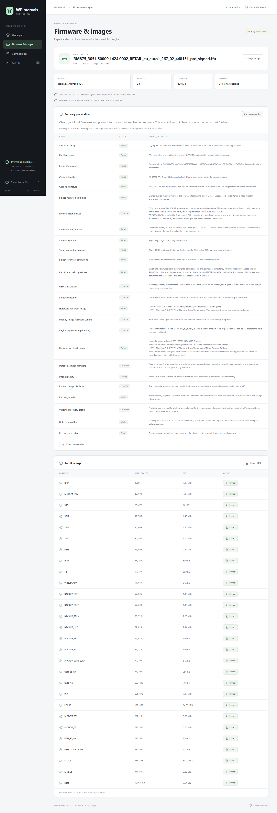

# OEM trust and applicability evidence

Catalog signature mathematics, certificate policy, hardware matching and device
acceptance are separate checks. Passing one cannot authorize a device write.
The native engine and browser WASM use the same bounded assessment code.

## Certificate assessment

After verifying the catalog signature, the inspector records the signer's issuer,
validity interval, SHA-256 certificate fingerprint and explicit local reference
time. Native file operations supply the host clock; the browser supplies its local
clock. Pure parser callers can omit time, leaving date validity unverified.

The supported profile checks:

- Validity dates at the supplied time, with no historical timestamp-policy claim.
- Explicit digital-signature key usage and code-signing extended key usage.
- Duplicate extensions, malformed supported extensions and unprocessed critical
  extensions. Missing explicit signing usages stay unverified.
- Catalog/image-local issuer signatures using RSA 2048–4096 / SHA-256, exact issuer names,
  available authority/subject key identifiers, issuer CA/key-cert-sign constraints
  and conservative path-length checks.
- Missing/ambiguous issuers, cycles and an eight-certificate path limit. The outer
  catalog limits still apply: 1 MiB, 16 certificates, DER depth 24 / 4096 nodes;
  assessment limits each certificate to 32 extensions.
- Authority key identifiers with a key ID and/or one directoryName plus serial.
  The directoryName must match the candidate certificate's issuer, and the serial
  must match its serial. Other name forms or ambiguous authority names stay unsupported.

These are limited checks informed by [RFC 5280 sections 4.2 and 6](https://www.rfc-editor.org/rfc/rfc5280).
This is **not a complete PKIX validator or OEM policy engine**. General path
building, name/policy constraints, OEM-specific EKU/policy interpretation,
revocation and authenticated signing timestamps are not implemented. Unsupported
critical constraints cannot produce a trusted result. Certificate dates outside
the local reference interval fail this preparation profile; this does not assert
that the phone uses the same historical-signing policy.

An internally consistent chain reaching a self-signed certificate establishes
mathematical consistency only. No embedded certificate, Nokia name, downloaded
file or host trust-store entry is automatically an OEM trust anchor. There are
currently no independently authenticated OEM anchors configured. Revocation is
unverified; no AIA/OCSP/CRL URL in a certificate is contacted. The result remains
unverified even when all supported checks pass, or fails when a supported policy
check fails. Mathematical catalog-signature status remains independently visible.

## Image hardware targeting

The inspector reads exactly `Windows/Packages/RegistryFiles/OEMSettings.reg` in
the FFU's MainOS NTFS partition. It observes `PhoneHardwareVariant` and optional
manufacturer/model fields only under `SYSTEM\Platform\DeviceTargetingInfo`.
It uses the existing partition-relative reader, 16 MiB I/O budget, 64 KiB cache,
and 64 KiB stored/expanded file limits. UTF-16LE/UTF-8 and single-member gzip are
supported. Duplicate values, deleted target keys, unsupported value formats and
contradictory variant/manufacturer-model values fail inspection of this evidence.

The narrow profile accepts `RM-` plus three or four digits. A manufacturer-model
prefix must end at the variant or an underscore, preventing `RM-8750` from matching
`RM-875`. The checklist compares the observed variant against previously read phone
information and fails contradictions. A matching RM number does not establish
regional/operator/product-code applicability, platform acceptance, rollback policy
or hardware-validated recovery support. These checks remain separate and blocked.

## Real RM-875 result

The local FFU explicitly identifies `RM-875`, manufacturer model
`RM-875_eu_euro1_267`, manufacturer `NOKIA` and model name `909`. It matches the
previously observed phone variant. Its version is older than the installed phone
firmware, so unvalidated-downgrade preparation still fails.

Its catalog embeds one signer certificate, issued by `CN=PK,O=Nokia`, valid from
`2012-09-06T11:13:39Z` to `2027-09-03T11:13:39Z`. Signing key usage, code-signing
EKU and supported critical-extension checks pass. Its issuer is absent from the
catalog but has now been found inside the same image, as described below. An
independently authenticated Nokia root and OEM policy/revocation evidence are
still needed. This does not establish OEM trust.

## Image-local production PK discovery

Native Rust and browser WASM read exactly
`EFIESP/Nokia/Security/Nokia_Production_PK.bin` through the FAT filesystem. The
shared sparse-partition reader enforces partition bounds, a 64 KiB cache/read
limit, a 16 MiB fetched-I/O budget and a 65,536-call budget. The file is limited
to 16 KiB before allocation. Missing files are optional; malformed or ambiguous
partitions and malformed present files are recorded as failed candidate evidence.

The narrow parser accepts a bounded `EFI_VARIABLE_AUTHENTICATION_2` envelope with
a DER CMS SignedData wrapper, followed by exactly one complete X.509
`EFI_SIGNATURE_LIST` entry with an empty signature header. It rejects unsupported
types, oversized/truncated lengths, extra entries and trailing data. Layout/GUID
definitions follow the primary [EDK II image-authentication header](https://github.com/tianocore/edk2/blob/master/MdePkg/Include/Guid/ImageAuthentication.h).
The envelope's timestamp, enrollment authorization and CMS signature are **not
authenticated**: this is issuer-candidate extraction, not variable-update verification.

The real 2,158-byte file has SHA-256
`837f40334c530c5a0d46b5010d314e3dcb1636d0389e5d57a61cbdaba3301432`.
Its self-signed `CN=PK,O=Nokia` certificate has SHA-256
`0f9cc68d5a94e0f4391be222997f6e186395986601b276e7b2612426b1ff0d36`,
SKI `519e4ac17548b1c8b3ef85ff3458699d49db0711`, serial 666, and validity
`2012-09-06T09:59:15Z` through `2042-08-30T09:59:15Z`.
Rust and independent Python cryptography verify the catalog signer's certificate
signature and this candidate's self-signature. The image's separate R&D PK has
the same subject name but a different key and fails the catalog-signature link.
The app only looks up the named production file; it does not select keys by name
from arbitrary binary matches or import the R&D file automatically.

The existing certificate-chain checklist now passes **internal consistency** for
this image. `CatalogReport.issuer_evidence` retains source/file/certificate hashes;
the root is still untrusted, revocation is unverified and recovery remains blocked.
See the [metadata-only evidence](../tests/fixtures/rm875-image-issuer-validation.json).

Indexed primary-source searches for the exact production filename, issuer SKI
and certificate fingerprint did not produce an independently authenticated Nokia
publication during this investigation. That limited search does not establish
that no such source exists. Same-image provisioning data is not evidence of what
is enrolled in the connected phone; the Qualcomm RKH below cannot fill that gap.

The Qualcomm boot-chain root-key hash is a different trust domain. Pinned upstream
2.9.2 hashes the SBL1 root certificate and compares it with the phone's RRKH in its
[unlock workflow](https://github.com/ReneLergner/WPinternals/blob/d8fd0aa516b16dc094df0422a3adc525af005c29/ViewModels/LumiaUnlockBootloaderViewModel.cs).
It is not a substitute for the missing catalog issuer or proof of regional
applicability. This implementation does not add an engineering-device bypass.

No phone query, mode switch or firmware/partition write was used for this offline
milestone. The [earlier signer/targeting record](../tests/fixtures/rm875-signer-targeting-validation.json)
preserves the result before image-local issuer discovery.

