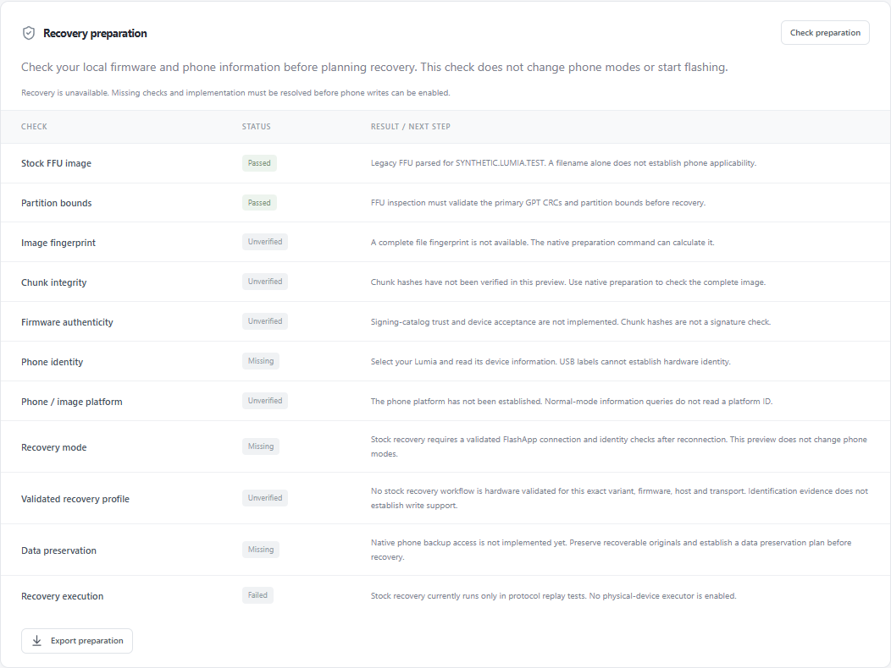

# Offline recovery preparation

Open a local FFU, then choose **Check preparation** in Firmware & images.
Selecting and identifying a Lumia is optional for an image-only report; phone
checks remain missing until its information is available.

The checklist explains format, partition bounds, image identity, chunk integrity,
firmware authenticity, phone identity/platform/mode, compatibility, data
preservation and execution. Native preparation hashes the complete file and checks
its chunk table with progress and cancellation. Browser preparation runs in a
worker and explicitly leaves full-file fingerprint/chunk checks unverified.
No preparation command switches modes, flashes, unlocks or reads phone storage.

Catalog signature, signed hash-table binding and firmware signer trust are now
separate checks in both native and browser preparation. A valid signature against
an embedded certificate does not establish an independently trusted OEM signer.
PLAT firmware metadata is scanned in bounded blocks. When absent, a bounded NTFS
lookup requires agreeing MainOS Nokia registry and DSM package revisions. The
checklist names these sources; missing or contradictory versions are explicit,
and filename versions never establish applicability. Older same-branch images
fail the unvalidated-downgrade check.
See [firmware validation and its limits](firmware-validation.md).

CLI:

```sh
wpi prepare-recovery firmware.ffu
# Optional: an explicitly selected USB device receives read-only information queries.
wpi prepare-recovery firmware.ffu --device-id '<id from wpi devices>'
```

Reports are advisory and always contain a blocked operation plan. Exports omit
persistent USB serials and host-specific device identifiers. A matching platform
or valid chunk table does not authenticate firmware or approve a downgrade.
Changes to firmware selection or selected phone clear the prior UI report.

Backup copying is currently implemented only for concrete replay block sources.
Tests cover aligned ranges, short transfers, timeouts/disconnects, cancellation
after a complete chunk, digest generation and atomic output publication. Simulated
results are marked `replay_only`. No phone backup button is enabled.

Next prerequisites for real operations: native storage identity and exclusive
access, preservation of recoverable data, authenticated firmware applicability,
verified mode transitions/reconnection, and complete hardware-tested recovery
executors. Device writing gates remain unchanged.

Browser preview with synthetic firmware (full-image integrity checks remain unverified):


